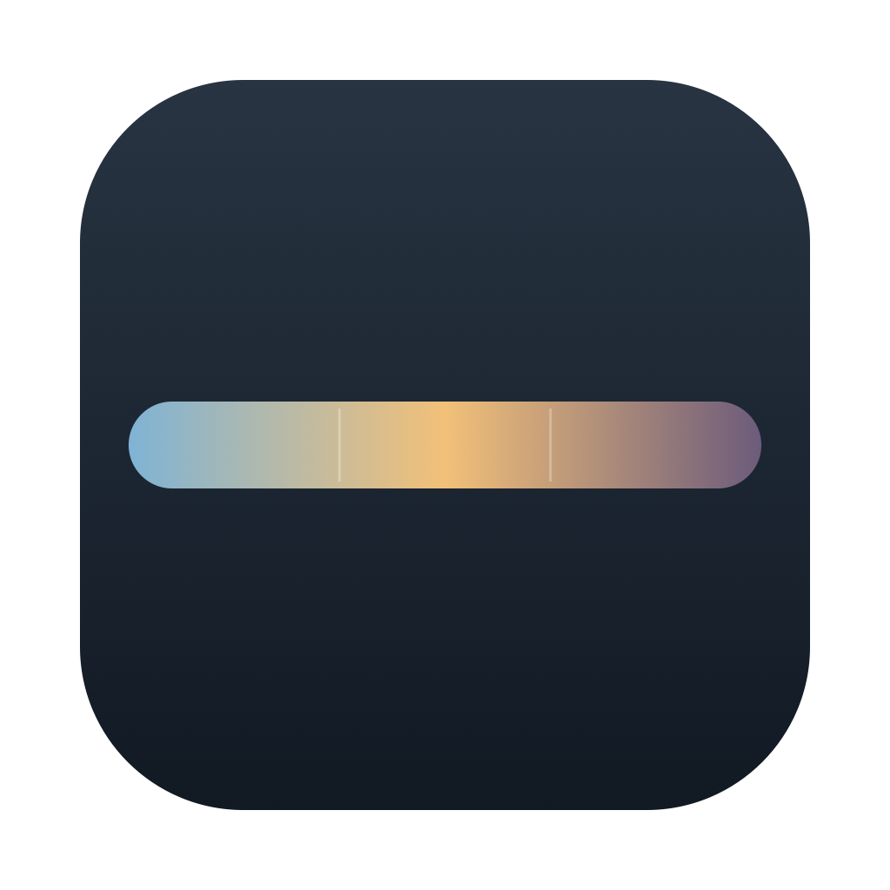
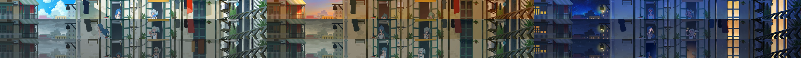
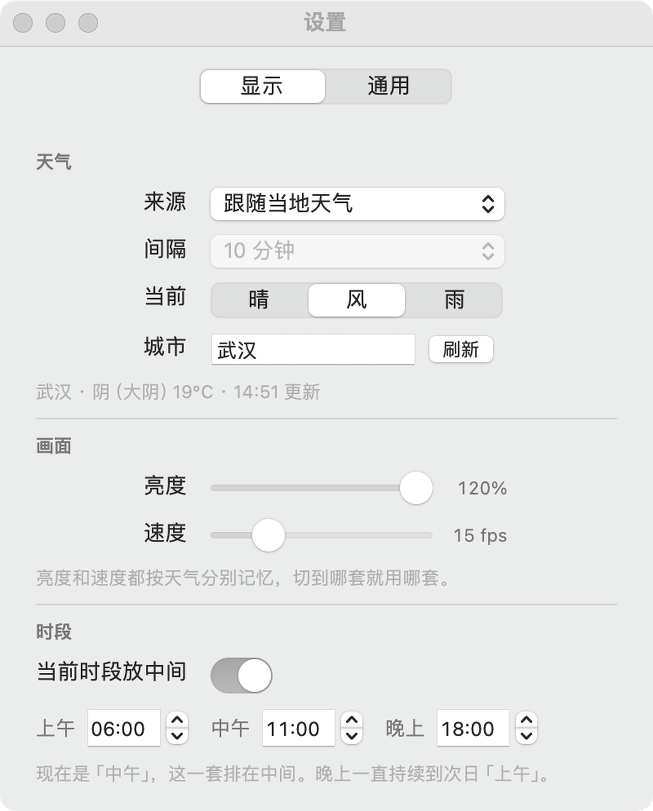
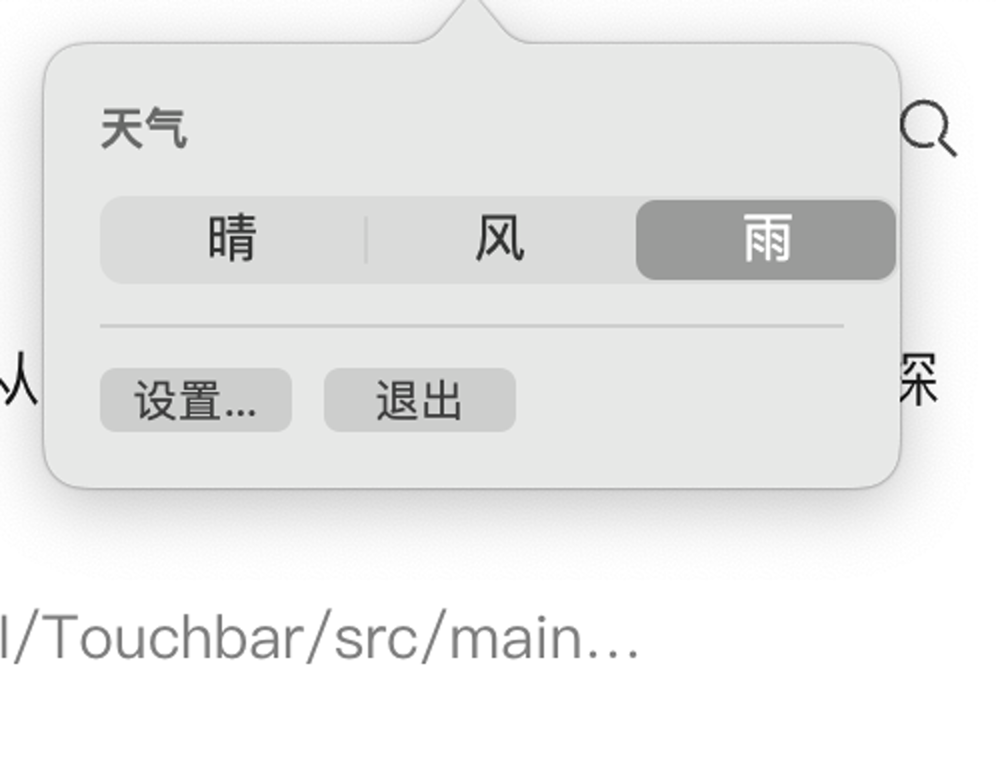

<div align="center">



# Touch Bar 装饰屏

把 Touch Bar 变成一块会动的天气壁纸。

A living weather wallpaper for the MacBook Pro Touch Bar.

[](https://github.com/RGCDDS/touchbar-display/releases)

[](./LICENSE)

[下载](https://github.com/RGCDDS/touchbar-display/releases) · [安装说明](docs/安装说明.txt) · [开发笔记](HANDOFF.md)

</div>



***如果你的Touchbar也和我一样不幸无法触但可以显示,可以试试重新利用起来它(这些素材一直存着也算是用起来了✌️)***

三套天气壁纸跟着你所在城市的真实天气自动切换——晴天用晴天那套，下雨换成雨，阴沉沉的时候换成刮风那套（云在动，配阴天）。每套又分早、中、晚三个时段，一共九段动画。

整条画面每秒重绘 18 次，但它不是视频，是每帧实时合成的：三张独立的动画各自循环，在接缝处做柔焦过渡，所以你能看到一条完整连贯的画面，而不是三段拼接。

## 功能

| 功能 | 说明 |
| --- | --- |
| **九套天气动画** | 晴 / 风 / 雨 × 早 / 中 / 晚，每套 2–6 秒循环，共 903 帧 |
| **跟随当地天气** | 读取所在城市的实时天气自动切换；也可以手动固定，或定时随机换 |
| **阴天分级** | 按云量和当天日照辐射分五档——小阴天用晴天素材，大阴天用风，不会出现「外面灰蒙蒙、条上大晴天」 |
| **亮度与速度** | 每套天气**单独记忆**，晴天可以调亮、雨天调慢，切换天气时自动套用 |
| **当前时段居中** | 早上把「早」那套放中间，到了中午自动重排，主画面始终在视线正中 |
| **像素位移** | 整条画面缓慢左右移动，避免固定构图在 OLED 上留下轮廓 |
| **闲置熄灭** | 一段时间没有操作，画面淡到纯黑（OLED 纯黑等于像素物理关闭）；一动就回来 |
| **只在指定 App 显示** | 白名单里的 App 在前台时才占住 Touch Bar，其他时候交还系统 Control Strip |
| **开机自启** | 登录后自动开始，不占 Dock、不占 ⌘-Tab |

## 截图

| 设置窗口 | 菜单栏面板 |
| --- | --- |
|  |  |

## 下载

到 [Releases](https://github.com/RGCDDS/touchbar-display/releases) 下载 `TouchBarDisplay-1.0.dmg`，打开后把 App 拖进 Applications。

**第一次打开会被系统拦下来**，因为这个 App 没有 Apple 开发者证书（一年 $99，个人项目没买）。解决办法：

- macOS 14 及更早：右键点 App → 打开 → 再点一次「打开」
- macOS 15 及以上：双击被拦 → 系统设置 → 隐私与安全性 → 「仍要打开」
- 会用终端：`xattr -dr com.apple.quarantine /Applications/TouchBarExp.app`

详细说明见 [安装说明](docs/安装说明.txt)。

## 系统要求

| 项目 | 要求 |
| --- | --- |
| 系统 | macOS 13.0 或更新 |
| 硬件 | 带 Touch Bar 的 MacBook Pro |
| 架构 | Intel 和 Apple Silicon 都支持（通用二进制） |

Touch Bar 只存在于这几代机器上：

| 机型 | 最高系统 | 支持 |
| --- | --- | --- |
| MacBook Pro 2016（13"/15"） | Monterey 12 | ❌ 系统太老 |
| MacBook Pro 2017 | Ventura 13 | ✅ |
| MacBook Pro 2018 / 2019 / 16" | Sonoma 14 | ✅ |
| MacBook Pro 13" M1 (2020) | 最新 | ✅ |

## 快捷键

| 操作 | 快捷键 |
| --- | --- |
| 切换天气（晴 → 风 → 雨） | `⌃⌥⌘T` |
| 打开设置 | `⌃⌥⌘,` |

菜单栏图标和 Dock 图标都可以在设置里关掉，关掉后只能靠这两个快捷键。

## 常见问题

| 问题 | 解决办法 |
| --- | --- |
| 提示「已损坏」或「无法验证开发者」 | 没签名导致的，见上面「下载」里的三种解法 |
| 打开后 Touch Bar 没变化 | 确认机型带 Touch Bar；再检查设置里「只在指定 App 显示」的白名单是不是把当前 App 排除了 |
| 一直弹定位权限 | 在设置里填一个城市名，填了之后就再也不会请求定位 |
| CPU 占用偏高 | 画面每帧都在重绘，占用和帧率成正比。把速度滑块调低（比如 15fps）能明显下降 |
| 天气显示「网络连不上」 | 直连 Open-Meteo 偶尔会 SSL 失败，会自动重试；挂了代理会更稳 |
| 系统 Control Strip 不见了 | 这是设计如此——它占住了整条 Touch Bar。想要回 Control Strip 就退出 App，或把当前 App 加进白名单外 |

## 从源码构建

需要 Xcode 命令行工具（`xcode-select --install`）。

```bash
git clone https://github.com/RGCDDS/touchbar-display.git
cd touchbar-display

./build.sh      # 编译打包，产物在 dist/
./install.sh    # 装到 /Applications 并启动
```

素材帧已经在仓库里（`assets/frames/`，1806 张 JPEG），clone 下来直接就能构建。

**想换成自己的素材**：准备 webm / mp4 视频，用 `tools/prepare_frames.sh` 抽帧，再跑 `tools/compress_frames.sh` 转 JPEG。这两个脚本需要 ffmpeg（`brew install ffmpeg`）。

**打包分发**：

```bash
./tools/make_dmg.sh    # 生成 dist/TouchBarDisplay-<版本>.dmg
```

## 实现说明

几个可能有人感兴趣的点：

- **合成而不是播放视频**。三张图各自循环，每帧在 2170×60 的位图上合成，接缝处用 50px 的重叠区做柔焦过渡。代价是 CPU（约 34% 单核），换来的是三套素材可以任意组合、随时切换时段。
- **CPU 花在哪**。实测过：合成只占 8%，剩下全是「把 2170×60 的位图推给 Touch Bar」这件事本身。只填黑时 CPU 只有 3%，一画真图就 34%。所以降帧率是唯一有效的优化手段。
- **阴天分级为什么用日照辐射**。只看云量不够——武汉 14 天的数据显示，云量是两极化的（要么 0–30%，要么 88–100%），而同样是「阴」，日照辐射能从 1 到 627 W/m²。用当天 9–16 点的平均辐射才能分出「厚云透光」和「阴沉沉」。
- **纯黑而不是撤下**。闲置时把画面淡到纯黑，而不是把 Touch Bar 交还系统。因为 Control Strip 那排固定图标才是最容易留下残影的。

更多细节（踩过的坑、实测数据、设计取舍）都在 [HANDOFF.md](HANDOFF.md)。

## 素材来源

九套动画素材来自 B 站 UP 主的壁纸视频，仅作个人学习和非商业用途。如果你要 fork 这个项目，建议换成自己有版权的素材——用 `tools/prepare_frames.sh` 抽帧替换即可，代码不用改。

## License

[MIT](./LICENSE)
